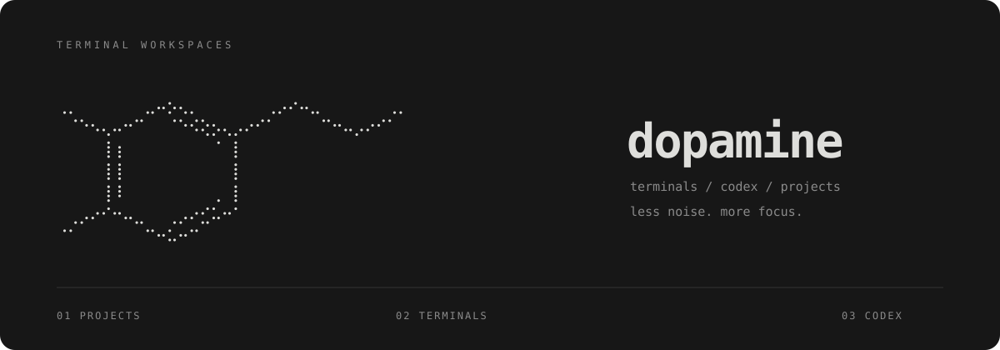
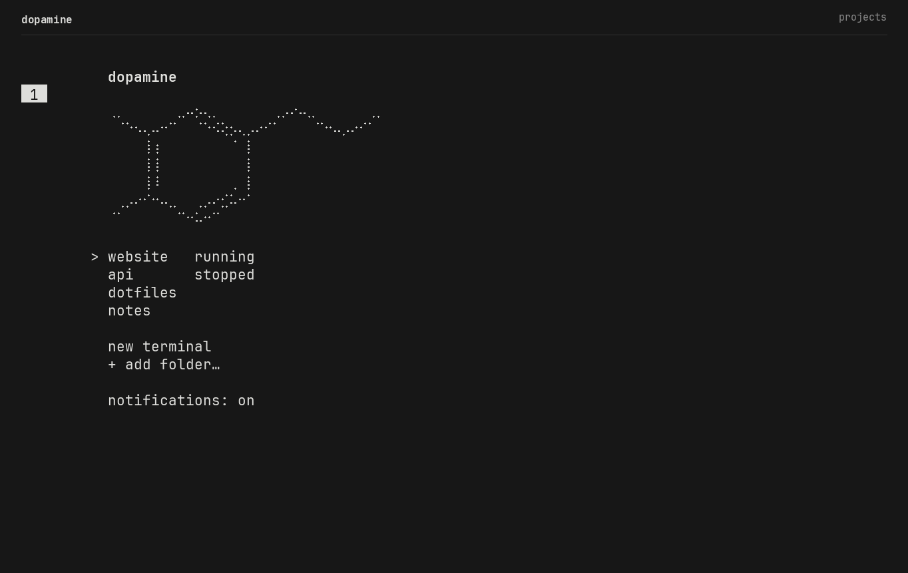
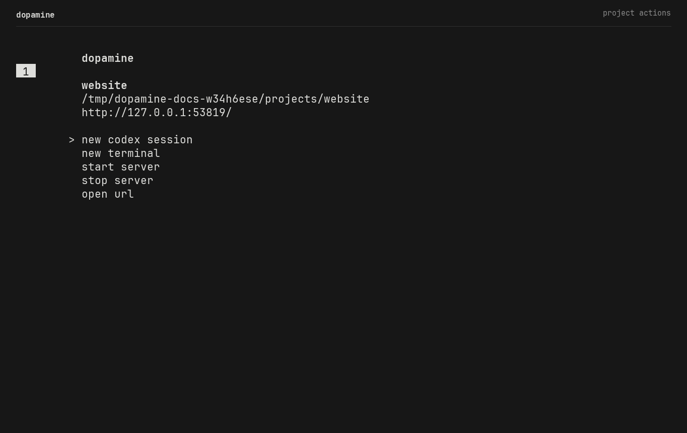
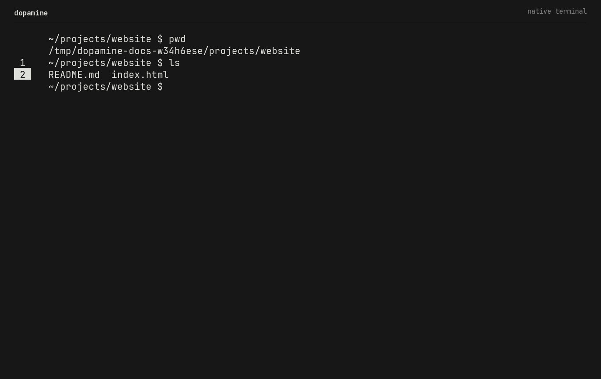

# dopamine



<p align="center">
  <strong>Your projects. Your terminals. One quiet workspace.</strong><br>
  A minimal terminal workspace for Codex, your shell, and project dev servers.
</p>

<p align="center">
  <a href="https://github.com/dr6m6/dopamine/actions/workflows/ci.yml"></a>
  <a href="LICENSE"></a>
  
</p>

<p align="center">
  <a href="#installation">Install</a> ·
  <a href="#features">Features</a> ·
  <a href="#screenshots">Screenshots</a> ·
  <a href="docs/installation.md">Installation guide</a> ·
  <a href="CONTRIBUTING.md">Contributing</a>
</p>

## Features

- **Projects within reach.** Folders in `~/projects` appear automatically. Add any other folder from the interface, with paste and `Tab` completion.
- **Native Codex.** Each session gets its own tab with the original Codex interface, terminal input, and scrollback.
- **Regular terminals.** Open a shell in a project's directory or your home directory. Switch tabs with keyboard shortcuts or a click.
- **Dev servers.** Start and stop project servers, check availability, and open local URLs in your browser. Each project has its own launch command.
- **Notifications.** Know when Codex asks a question or finishes a turn, with the current tab number. Mute all notifications with one toggle.
- **Persistent workspaces.** Leaving the interface keeps terminals and servers running in tmux. Open dopamine again to return.
- **Less visual noise.** Numbers on the left, neutral colors, inverted selection, and our dotted molecule. Press `?` when you need the shortcuts.

## Screenshots

The actual TUI running with disposable demo projects in an isolated tmux, captured and rendered to PNG. No personal projects or conversations are shown.



<table>
  <tr>
    <td width="50%"></td>
    <td width="50%"></td>
  </tr>
  <tr>
    <td align="center">Actions for the selected project</td>
    <td align="center">Your shell in its own tab</td>
  </tr>
</table>

## Installation

The current supported setup is **Linux x86_64 with Nix**, tested on NixOS. You need Git, Python 3, and Nix with `nix-command` and `flakes` enabled. Codex sessions require the existing system launcher at `/run/current-system/sw/bin/codex-vpn`; dopamine's installer does not create it. Projects, regular terminals, and dev servers work independently of Codex.

```sh
git clone https://github.com/dr6m6/dopamine.git
cd dopamine
./install.sh
export PATH="$HOME/.local/bin:$PATH"
dopamine
```

The installer builds the pinned Nix package and adds the command to `~/.local/bin`. Keep the clone: the installed command uses its sources. The first build can take a few minutes; subsequent launches use Nix's cache.

[Full guide: requirements, installation, updates, NixOS module, and troubleshooting →](docs/installation.md)

## First run

1. Open `dopamine` in a terminal at least **46 × 16** cells; **80 × 24** or larger is more comfortable.
2. Select a project with the arrow keys and press `Enter`.
3. Choose `new codex session`, `new terminal`, or a server action. `Esc` returns to the project list.
4. Switch tabs with `Alt+1…9` or `Alt+←/→`. Tab **1** is the dashboard.
5. Press `?` on the dashboard for help. Press `q` to leave the interface while keeping workspaces running.

The `new terminal` action below the project list opens a shell in `~`; the same action in a project's menu opens it in that project's directory. Removing an external folder with `remove from list` only removes its registry entry.

## Configure a dev server

`dopamine projects` prints the current registry. Settings live in `~/.config/dopamine/projects.json`, or `$XDG_CONFIG_HOME/dopamine/projects.json`.

```json
{
  "projects": [
    {
      "id": "website",
      "name": "website",
      "path": "~/projects/website",
      "launch": ["nix", "develop", "-c", "npm", "run", "dev"],
      "app_url": "http://localhost:5173/"
    }
  ]
}
```

Add `launch` and `app_url` to the relevant entry, preserving other projects and registry fields. Launch commands are argument arrays executed from the project directory; the server must stay in the foreground. Normal local URLs use `localhost`, `127.0.0.1`, or `::1`. Projects with a `launch` command appear first and show a server status.

Override the automatic discovery directory when launching:

```sh
DOPAMINE_PROJECTS_ROOT="$HOME/work" dopamine
```

## Cloud tasks and server autostart

Choose **new cloud task** (`c`) in a project menu to send work to a configured Codex Cloud environment. A cloud under the tab number distinguishes remote work; the tab shows working/completed/failed status and the last check time. Open saved work through **cloud tasks…**. Cloud commands use the existing Codex login and VPN launcher.

Projects with a server command also have **server autostart** (`a`): off, when dopamine opens, or at login through a user systemd service. Select a mode with arrows and save with Enter.

[Setup, controls, status semantics and recovery →](docs/cloud-and-autostart.md)

## Keyboard shortcuts

| Keys | Action |
|---|---|
| `↑/↓`, `j/k` | Select a project or action |
| `Enter` / `Esc` | Open or execute / go back |
| `n` / `t` in a project menu | New Codex session / project terminal |
| `s` / `x` / `o` in a project menu | Start server / stop server / open URL |
| `Alt+1…9`, click a number | Switch to a tab |
| `Alt+←/→` | Previous / next tab, including numbers above 9 |
| `Tab`, `Shift+Tab` on the dashboard | Next / previous tab |
| `Ctrl+w` | Close the tab; a running shell or Codex requires confirmation |
| `?` | Show dashboard help |
| `q`, `Ctrl+c` on the dashboard | Leave the interface, keeping workspaces running |

Inside a terminal, regular keys belong to your shell or Codex. `exit` ends the shell and closes its tab.

## Update and uninstall

```sh
cd /path/to/dopamine
git pull --ff-only
dopamine
```

Every launch of the installed command builds the current clone. Existing terminals and servers keep running. Open a new Codex session to pick up changes to notification handlers.

```sh
./uninstall.sh
```

This removes the installed command while keeping projects, logs, settings, and running sessions. See the [installation guide](docs/installation.md) for data locations and troubleshooting.

## Development

```sh
nix develop path:. -c make build
nix develop path:. -c make test
nix build path:.#dopamine
```

Terminal tests use an isolated tmux and a fake Codex process, with no model API calls. See [CONTRIBUTING.md](CONTRIBUTING.md).

[MIT License](LICENSE).
