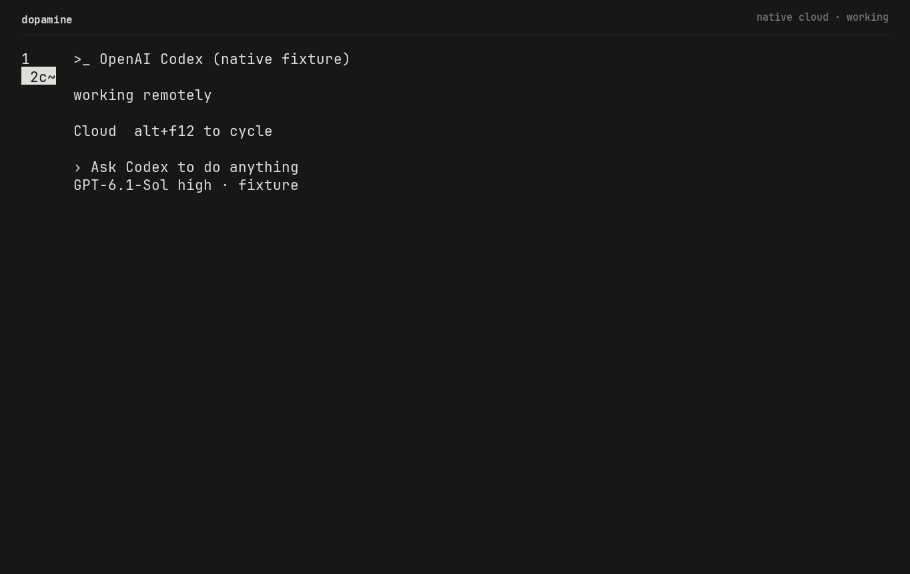
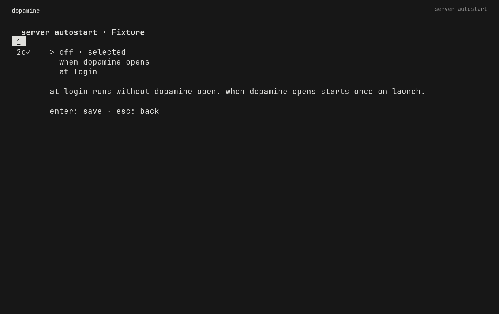

# Cloud tasks and server autostart

## Native Codex Cloud sessions

Open a project's menu and choose **new cloud session** (`c`). Dopamine opens the installed Codex terminal interface, enables its Cloud connection for this invocation and switches the empty conversation to Cloud before exposing it for input. It uses the existing Codex login and `/run/current-system/sw/bin/codex-vpn`.

This is the actual native Codex interface: use **/model** to choose a model and reasoning effort from the account's Cloud catalog, **/status** to inspect the active conversation, and **/resume** to reopen conversations. Native Cloud is an opt-in preview in Codex **0.169.0 or newer** on supported Linux/macOS clients; dopamine's currently supported installation remains Linux/NixOS. An account or server without this connection produces an error tab rather than an editable local fallback.

Every tab takes **one row**. `2c` means the current thread has been identified as Cloud, `2c~` means working/connecting, `2c✓` means a ready thread with recorded token usage, and `2c!` means a connection/startup error. A native session deliberately switched to Local shows `l` when identified. After changing/resuming a conversation whose host cannot be identified, the badge becomes `?`; inspect native `/status` rather than assuming it is Cloud. Ordinary local tabs keep their existing labels. Clicking a row selects it; cloud startup remains inaccessible through dopamine navigation until the handoff completes.

The native client prepares its empty local conversation in a private directory under the dopamine state directory, with only credential-free GitHub origin metadata. Project source files, project Codex settings and project trust are not copied or changed. If Codex asks for folder trust, dopamine accepts only the selected native trust prompt for its own verified private directory; Codex records that trust using its normal mechanism. It never automatically trusts the project directory. Native Cloud derives its remote checkout from that metadata. Local uncommitted changes are not uploaded. Non-GitHub folders open a Cloud workspace without an inferred repository.

The host-switch shortcut and terminal-title metadata are invocation-only settings. The native TUI retains control of its own preferences and conversation storage; choosing a model or changing a host follows Codex's own persistence behavior. Local sessions opened with `n` keep their existing launcher and settings. The terminal title supplies current run-state and thread ID for the rail; dopamine does not parse model prose to decide whether work is running.

Closing the tab leaves submitted Cloud work running. Ctrl+w asks for confirmation to protect unsent text. If the Cloud stream ends, the native interface reports it; reopen the conversation/session to reconnect. No automatic model task is sent during startup, model discovery or status display.

### Previously saved batch tasks

**Cloud tasks…** in the project menu retains access to tasks created by the earlier `codex cloud exec` integration. Existing task IDs and files are preserved. Open an item to check its state; `r` refreshes, `o` opens its result and `d` shows the diff. Native conversations use Codex's own `/resume` instead of this legacy task list.

The old CLI's `PENDING` status combines queueing and running, so saved batch tasks still display **working · queued or running**. Their environment setting (`cloud_environment`) remains intact. A saved uncertain submission can still be attached to its task ID/link without submitting it again.

## Server autostart

A project with a configured `launch` command has **server autostart** (`a`) in its menu. Choose with arrows and save with Enter:

| Mode | When the server starts |
|---|---|
| off | Only when you choose start server |
| when dopamine opens | Once at each ordinary dopamine launch; an existing managed server is reused |
| at login | Through an enabled user systemd service, without opening dopamine |

Changing the mode affects future starts and does not stop a currently running server. Use **start server** to start immediately and **stop server** to stop either a tmux server or an owned systemd service. Stopping a login service keeps autostart enabled for the next login. To prevent that, select off or when dopamine opens.

Login mode uses a dedicated `dopamine-server-<hash>.service` in `$XDG_CONFIG_HOME/systemd/user` (default `~/.config/systemd/user`). It runs the configured foreground command in the project's directory, preserves `launch_vpn`, and restarts failures through systemd. It does not enable linger, request root access, or change NixOS, Home Manager, Codex, VPN, or other services. Existing externally managed units are not overwritten. If user linger is already enabled independently, the user manager may start before an interactive login.

Installed source builds use the existing stable `source-package/bin/dopamine` GC root, so a package update does not strand the service on an old Nix store hash. NixOS package installations use the stable system command when it refers to the current package. Temporary unrooted `nix run` packages must be installed before enabling login mode. Keep the project directory, source installation and configured commands available. Select off before uninstalling if you also want to disable future login starts; uninstall preserves project settings and services.

The service reads current project settings on every start. Its environment contains the captured PATH, HOME and dopamine registry/state locations; use the project's declared `nix develop -c …` launch command for dependencies. Environment-specific secrets should be supplied through the project's existing mechanisms. Status failures name the journal command, `journalctl --user -u dopamine-server-<hash>.service`.

Server autostart is per project in `projects.json`: `server_autostart` (`off`, `dopamine`, `login`). Edits preserve unknown settings and missing project entries, including earlier `cloud_environment` values.

## Implementation choice and verification

Reuse Codex 0.169's native `tui_multi_backend` Cloud connection, model catalog and full terminal interface instead of recreating a chat client or authentication layer. The previous batch commands remain only for existing saved tasks; no new daemon or dependency is needed. Native systemd user services provide login lifecycle and process supervision; the existing tmux launcher already covers starting when dopamine opens. This is a smaller integration than adding a second background daemon.

Sources: [OpenAI CLI reference](https://learn.chatgpt.com/docs/developer-commands?surface=cli), [cloud environments](https://learn.chatgpt.com/docs/environments/cloud-environments), [native Cloud release notes](https://learn.chatgpt.com/docs/changelog), [native Cloud model selection](https://github.com/openai/codex/pull/60651), [systemd services](https://www.freedesktop.org/software/systemd/man/latest/systemd.service.html).

`make test` includes cloud/autostart unit tests and an isolated real tmux/TUI/HTTP scenario. Its Codex Cloud commands and systemd manager are fixtures: it verifies transitions, controls, registry persistence and real foreground server start/stop without making a model call or changing the user's services. Generated units are also checked with the real systemd parser when available. A fixture run does not replace a model task or an actual login. The installed native client was also checked against the signed-in account: Cloud connection and `/model` catalog discovery were exercised without sending a model task.
